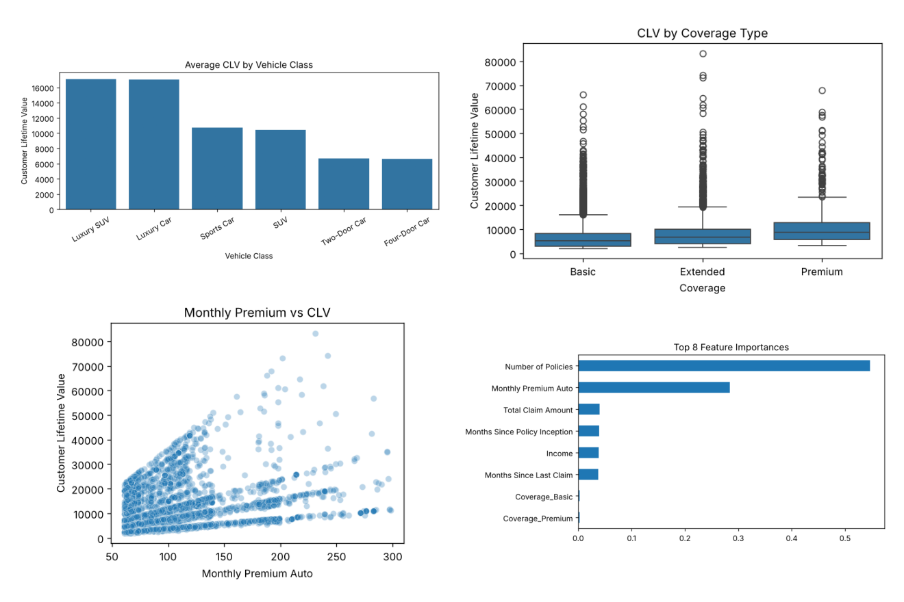

# Customer Lifetime Value (CLV) Prediction - Auto Insurance

MLBA Assignment 2 | Machine Learning for Business Applications | MBA - Business Analytics

## Business Problem
An auto insurance company has a limited marketing and retention budget and does not know which customers will be worth the most over time.

## Objective
Build a regression model that predicts the Customer Lifetime Value (CLV) of a customer, and turn it into a web app that gives a prediction and a recommended action.

## Dataset
- **Name:** Auto Insurance Customer Lifetime Value (IBM Watson Marketing Customer Value Analysis)
- **Source:** Public dataset on Kaggle
- **Rows / Columns:** 9,134 / 24
- **Target:** `Customer Lifetime Value` (net profit from a customer over their lifetime, in dollars)
- **Predictors used (8):** Monthly Premium Auto, Number of Policies, Income, Total Claim Amount, Months Since Last Claim, Months Since Policy Inception, Coverage, Vehicle Class

## Methodology
Data -> Cleaning -> EDA -> Feature Preparation -> Train/Test Split (80/20) -> Model Training -> Evaluation -> Model Saving (`model.pkl`) -> Streamlit App -> Deployment

## Model Used
Random Forest Regressor (200 trees) inside a scikit-learn Pipeline (one-hot encoding + model). Compared with Linear Regression as a baseline.

## Model Performance (test set, 1,827 customers)
| Model | MAE | RMSE | R2 |
|---|---|---|---|
| Linear Regression | $4,017 | $6,607 | 0.153 |
| Random Forest | $1,521 | $3,997 | 0.690 |

## Business Insights
- Number of Policies and Monthly Premium are the most important factors.
- Luxury SUV / Luxury Car owners have more than double the average CLV of Four-Door / Two-Door car owners.
- CLV rises from Basic to Extended to Premium coverage.
- The customers the model ranks in its top 20% hold about 44% of the total CLV, so the model is good at finding valuable customers.

## Limitations
Single company and period; the data looks partly synthetic; weaker on very high CLV customers; shows patterns, not cause and effect.

## How to Run the Application
```
pip install -r requirements.txt
streamlit run app.py
```

## Project Structure
```
app.py  model.pkl  requirements.txt  README.md
data/dataset.csv
notebooks/model_development.ipynb
images/dashboard.png
```

## Screenshots


## Deployed Application Link
ADD YOUR STREAMLIT COMMUNITY CLOUD LINK HERE

## Group Members
Sanjay, Spandana, Rathan, Himnish, Sumaiya
